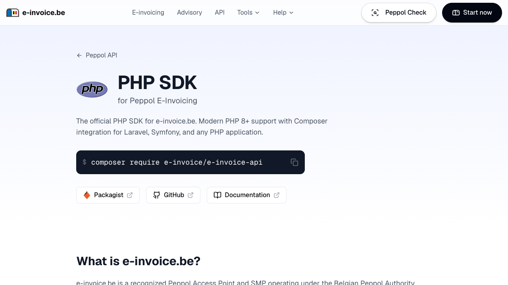

# e-invoice.be PHP API library

[](https://e-invoice.be/peppol-api/php)

This library gives access to the [e-invoice.be](https://e-invoice.be) Peppol API from any PHP 8.1+ application. With it you can create, validate, send and receive electronic invoices and credit notes on the Peppol network.

e-invoice.be maintains this library. All the code is written and maintained by hand.

To get an API key, [make a free account](https://app.e-invoice.be/register?ref=php) and register your company.

## Documentation

- The guides are on [docs.e-invoice.be](https://docs.e-invoice.be).
- The REST API reference is on [api.e-invoice.be/docs](https://api.e-invoice.be/docs).
- An overview of the PHP SDK is on [e-invoice.be/peppol-api/php](https://e-invoice.be/peppol-api/php).

## Installation

Install the package with [Composer](https://getcomposer.org):

```sh
composer require e-invoice/e-invoice-api
```

The library uses [PSR-18](https://www.php-fig.org/psr/psr-18/) to send requests and [PSR-17](https://www.php-fig.org/psr/psr-17/) to build them. It finds the installed implementations automatically. If your application has no PSR-18 HTTP client, install one, for example:

```sh
composer require symfony/http-client nyholm/psr7
```

## Usage

```php
<?php

use EInvoiceAPI\Client;

$client = new Client(apiKey: getenv('E_INVOICE_API_KEY'));

$document = $client->documents->create(
  documentType: 'INVOICE',
  invoiceID: 'INV-2026-001',
  invoiceDate: '2026-10-11',
  dueDate: '2026-11-10',
  currency: 'EUR',
  vendorName: 'My Company BV',
  vendorTaxID: 'BE0123456789',
  customerName: 'Customer NV',
  customerTaxID: 'BE0987654321',
  customerPeppolID: '0208:0987654321',
  items: [
    [
      'description' => 'Consulting',
      'quantity' => 2,
      'unitPrice' => 100,
      'taxRate' => '21.00',
    ],
  ],
);

var_dump($document->id);

// Send the document on the Peppol network
$client->documents->send($document->id);
```

### Configuration

The constructor of the client has two optional parameters. Each one has an environment variable as fallback.

| Parameter | Environment variable | Default                    |
| --------- | -------------------- | -------------------------- |
| `apiKey`  | `E_INVOICE_API_KEY`  | none                       |
| `baseUrl` | `E_INVOICE_BASE_URL` | `https://api.e-invoice.be` |

```php
<?php

use EInvoiceAPI\Client;

// Reads E_INVOICE_API_KEY and E_INVOICE_BASE_URL from the environment
$client = new Client;
```

The client sends the API key as a bearer token in the `Authorization` header.

### Parameters

The methods use named parameters. All optional parameters have a default value, thus you set only the ones that you need.

The parameter names are in camelCase (`customerPeppolID`). The library converts them to the snake_case names of the REST API (`customer_peppol_id`). The keys of nested arrays, such as the entries of `items`, are also in camelCase.

For parameters with a fixed set of values you can give a string or the related enum:

```php
<?php

use EInvoiceAPI\Documents\DocumentType;

$client->documents->create(documentType: DocumentType::CREDIT_NOTE);
```

### Value objects

Some nested parameters accept a value object as an alternative to an array. Use the static `with` constructor with named parameters to make a value object:

```php
<?php

use EInvoiceAPI\Documents\DocumentAttachmentCreate;

$attachment = DocumentAttachmentCreate::with(
  fileName: 'timesheet.pdf',
  fileData: base64_encode(file_get_contents('timesheet.pdf')),
  fileType: 'application/pdf',
);

$client->documents->create(attachments: [$attachment]);
```

Builders are also available: `(new DocumentAttachmentCreate)->withFileName('timesheet.pdf')`.

### Resources

The client has one property for each resource of the API. Together they cover the 40 endpoints of the API.

| Property                           | Methods                                                                                 |
| ---------------------------------- | --------------------------------------------------------------------------------------- |
| `$client->documents`               | `create`, `retrieve`, `delete`, `createFromPdf`, `retrieveTimeline`, `send`, `validate` |
| `$client->documents->attachments`  | `retrieve`, `list`, `delete`, `add`                                                     |
| `$client->documents->ubl`          | `createFromUbl`, `get`                                                                  |
| `$client->inbox`                   | `list`, `listInvoices`, `listCreditNotes`                                               |
| `$client->outbox`                  | `listDraftDocuments`, `listReceivedDocuments`                                           |
| `$client->drafts`                  | `list`                                                                                  |
| `$client->mailbox`                 | `retrieve`, `list`, `downloadAttachment`, `reprocess`                                   |
| `$client->validate`                | `validateJson`, `validatePeppolID`, `validateUbl`                                       |
| `$client->lookup`                  | `retrieve`, `retrieveParticipants`                                                      |
| `$client->conversion`              | `createFromPdf`, `retrieve`, `retrieveResult`                                           |
| `$client->me`                      | `retrieve`                                                                              |
| `$client->stats`                   | `retrieve`                                                                              |
| `$client->webhooks`                | `create`, `retrieve`, `update`, `list`, `delete`, `retrieveHistory`, `test`             |

Some examples:

```php
<?php

// Make sure that the receiver is on the Peppol network
$check = $client->validate->validatePeppolID(peppolID: '0208:0987654321');
var_dump($check->isValid);

// Search for Peppol participants
$participants = $client->lookup->retrieveParticipants(query: 'e-invoice', countryCode: 'BE');

// Validate a document before you send it
$validation = $client->documents->validate($document->id);
var_dump($validation->isValid, $validation->issues);

// Get a notification when a document arrives
$webhook = $client->webhooks->create(
  events: ['document.received'],
  url: 'https://example.com/webhooks/e-invoice',
);

// Read the details of your account
$me = $client->me->retrieve();
var_dump($me->name, $me->peppolIDs);
```

### File uploads

The methods that upload a file accept the contents of the file as a string, or a `EInvoiceAPI\Core\FileParam`. Use `FileParam` to set the file name and the content type:

```php
<?php

use EInvoiceAPI\Core\FileParam;

// From a string
$result = $client->documents->createFromPdf(
  file: FileParam::fromString(
    file_get_contents('invoice.pdf'),
    filename: 'invoice.pdf',
    contentType: 'application/pdf',
  ),
);

// From a resource. The file name comes from the path of the resource.
$document = $client->documents->ubl->createFromUbl(
  file: FileParam::fromResource(fopen('invoice.xml', 'r'), contentType: 'application/xml'),
);
```

The library reads a resource from its current position and does not close it.

### Pagination

The list methods of `inbox`, `outbox`, `drafts` and `mailbox` are paginated. They return a `EInvoiceAPI\DocumentsNumberPage`, which can get the subsequent pages for you:

```php
<?php

use EInvoiceAPI\Client;

$client = new Client(apiKey: getenv('E_INVOICE_API_KEY'));

$page = $client->inbox->list(pageSize: 50);

// The items of the current page
foreach ($page->getItems() as $item) {
  var_dump($item->id);
}

// The items of the current page and all subsequent pages.
// The library makes the necessary requests.
foreach ($page->pagingEachItem() as $item) {
  var_dump($item->id);
}

// Or get the pages one at a time
if ($page->hasNextPage()) {
  $page = $page->getNextPage();
}
```

A page also has the properties `page`, `pageSize`, `pages` and `total`.

### Handling errors

When the library cannot connect to the API, or when the API returns a status code that is not a success (4xx or 5xx), the library throws a subclass of `EInvoiceAPI\Core\Exceptions\APIException`:

```php
<?php

use EInvoiceAPI\Core\Exceptions\APIConnectionException;
use EInvoiceAPI\Core\Exceptions\APIStatusException;
use EInvoiceAPI\Core\Exceptions\APITimeoutException;
use EInvoiceAPI\Core\Exceptions\RateLimitException;

try {
  $document = $client->documents->retrieve('doc_123');
} catch (APITimeoutException $e) {
  echo "The request timed out", PHP_EOL;
} catch (APIConnectionException $e) {
  echo "The server could not be reached", PHP_EOL;
  var_dump($e->getPrevious());
} catch (RateLimitException $e) {
  echo "A 429 status code was received; we should back off a bit.", PHP_EOL;
} catch (APIStatusException $e) {
  echo "Another non-200-range status code was received", PHP_EOL;
  echo $e->getMessage();
}
```

The error types are as follows:

| Cause            | Error Type                     |
| ---------------- | ------------------------------ |
| HTTP 400         | `BadRequestException`          |
| HTTP 401         | `AuthenticationException`      |
| HTTP 403         | `PermissionDeniedException`    |
| HTTP 404         | `NotFoundException`            |
| HTTP 409         | `ConflictException`            |
| HTTP 422         | `UnprocessableEntityException` |
| HTTP 429         | `RateLimitException`           |
| HTTP >= 500      | `InternalServerException`      |
| Other HTTP error | `APIStatusException`           |
| Timeout          | `APITimeoutException`          |
| Network error    | `APIConnectionException`       |

`APITimeoutException` is a subclass of `APIConnectionException`, so catch it first.

### Retries

The library automatically retries some errors 2 times by default. If the response has a `Retry-After` header with a number of seconds, the library waits that time before the retry.

The library retries these status codes: 408 Request Timeout, 409 Conflict, 429 Rate Limit and all codes >= 500. It does not retry connection errors and timeouts.

Use the `maxRetries` option to change or disable the retries for a request:

```php
<?php

use EInvoiceAPI\RequestOptions;

$document = $client->documents->retrieve(
  'doc_123',
  requestOptions: RequestOptions::with(maxRetries: 5),
);
```

## Advanced concepts

### Raw responses

Each resource has a `raw` property with the same methods. These methods return the [PSR-7](https://www.php-fig.org/psr/psr-7/) response, thus you can read the status code and the headers. Call `parse()` to get the typed result:

```php
<?php

$response = $client->documents->raw->retrieve('doc_123');

var_dump($response->getStatusCode());
var_dump($response->getHeaderLine('Content-Type'));

$document = $response->parse();
```

### Using a different HTTP client

By default the library uses the PSR-18 client and the PSR-17 factories that [`php-http/discovery`](https://github.com/php-http/discovery) finds. To use a different PSR-18 client for a request, for example one with your timeout or proxy configuration, give it as the `transporter` option:

```php
<?php

use EInvoiceAPI\RequestOptions;
use Symfony\Component\HttpClient\Psr18Client;

$me = $client->me->retrieve(
  requestOptions: RequestOptions::with(transporter: new Psr18Client),
);
```

### Making custom or undocumented requests

#### Undocumented parameters

You can send undocumented query parameters and headers to any endpoint with the `extraQueryParams` and `extraHeaders` request options:

```php
<?php

use EInvoiceAPI\RequestOptions;

$document = $client->documents->create(
  requestOptions: RequestOptions::with(
    extraQueryParams: ['my_query_parameter' => 'value'],
    extraHeaders: ['my-header' => 'value'],
  ),
);
```

Note: an extra header overrides the header of the same name that the library sends.

#### Undocumented endpoints

To make a request to an undocumented endpoint, use `$client->request`. The request keeps the authentication, the retries and the error handling of the library:

```php
<?php

$response = $client->request(
  method: 'post',
  path: '/undocumented/endpoint',
  query: ['dog' => 'woof'],
  headers: ['useful-header' => 'interesting-value'],
  body: ['hello' => 'world'],
);

var_dump($response->getStatusCode());
```

## Versioning

This package follows [SemVer](https://semver.org/spec/v2.0.0.html) conventions. While the major version is `0`, a breaking change increases the minor version. See the [changelog](CHANGELOG.md) for the changes in each version.

This package considers improvements to the (non-runtime) PHPDoc type definitions to be non-breaking changes.

## Requirements

PHP 8.1 or higher, and an implementation of PSR-18 (HTTP client) and PSR-17 (HTTP factories).

## Contributing

See [the contributing documentation](CONTRIBUTING.md). To report a security problem, see [the security policy](SECURITY.md).
